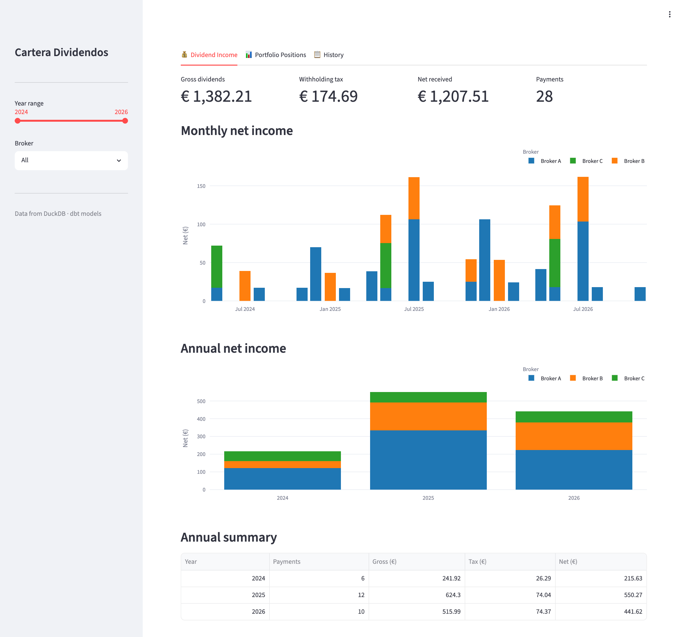

# stock-portfolio-etl

[](https://github.com/iplarranaga/stock-portfolio-etl/actions/workflows/pipeline.yml)

ETL for a personal dividend portfolio: broker exports → DuckDB → dbt → Google Sheet and Streamlit dashboards.

```
Broker A XML ──┐
Broker B XLS ──┤  Python loaders  →  DuckDB raw.*  →  dbt staging → intermediate → marts  →  Google Sheet
manual CSVs ───┤                                                                         →  Streamlit
ECB FX API ────┘
```

Marts: dividends (`fct_dividends`), positions and P&L (`fct_positions`, `fct_pnl`), and Spanish tax
reporting (`fct_tax_report` with foreign vs Spanish withholding, `fct_capital_gains` with FIFO and the
two-month rule), all in euros at the ECB rate.



*The dashboard running on the fictional sample portfolio.*

## Try it on the sample data

`sample_data/` holds a made-up portfolio in the real export formats (every company, ticker and amount is
fictional), so the whole pipeline runs without private files:

```bash
pip install -r requirements.txt
CARTERA_DATA_DIR=sample_data ./refresh.sh                       # builds database/sample_data.db
CARTERA_DB_PATH=database/sample_data.db streamlit run app.py    # dashboard at http://localhost:8501
```

The ECB loader needs internet access. With a non-default `CARTERA_DATA_DIR` the run writes to its own
database and never exports to the Google Sheet. CI runs the same command on every push.

## Design choices

- **Loaders only land raw data, dbt does the rest.** Python parses each broker's format into `raw.*`
  as is; renaming, typing, dedup and business rules live in dbt models, where they are versioned and tested.
- **One sign convention across brokers.** `net_cash` is negative when money goes out (buy, fees included)
  and positive when it comes in (sell, net of fees), so Broker A, Broker B and hand-kept trades union cleanly.
- **Overlapping exports are expected.** Broker exports are re-downloaded with overlapping date ranges and
  all files are loaded. Staging numbers identical rows within each file and keeps one per occurrence, so
  overlaps collapse but two genuine same-day payments survive.
- **Broker A dividend accruals come in pairs** (+ on the ex-date, − on the pay date). Summing them nets every
  dividend to zero, so staging keeps one row per dividend with the pay-date FX rate and an `is_paid` flag.
- **ECB rates for tax.** The Spanish return converts foreign amounts at the ECB reference rate on the
  payment or trade date. `*_eur` columns use it (forward-filled over weekends and holidays); `*_base`
  columns keep the broker's own rate for comparison. Amounts the broker already settled in euros use
  the euros actually paid.
- **FIFO across brokers.** Spanish law (art. 37.2 LIRPF) pools identical securities wherever they are held,
  so a sale at one broker can consume older shares bought at another. `fct_capital_gains` turns each buy
  and sell into a slice of the cumulative quantity per ticker and joins overlapping slices, so FIFO stays
  set-based SQL with no loops. Converting buy and sale each at its own ECB rate includes the currency gain.
- **Two-month rule.** A loss is not deductible in the proportion that the same security was bought within
  two months before or after the sale (art. 33.5.f LIRPF). The model computes that proportion and reports
  the deferred part separately from the computable gain or loss.
- **Free rights cost zero.** Subscription rights from scrip dividends (`.D` tickers) are sold with an
  acquisition value of 0, and sales with no matching purchase are flagged `needs_review`.
- **Private data stays out of git.** Holdings, including the ticker metadata, are a raw table loaded from a
  gitignored CSV rather than a dbt seed.

## Real data setup

Requires Python ≤ 3.12 (or 3.14 with `mashumaro>=3.22`).

Private inputs are gitignored and must be provided locally:

| Path | Content |
|---|---|
| `data/broker_a/` | Broker A XML statement exports `Operaciones_*.xml`, `dividendos_*.xml` |
| `data/broker_b/` | Broker B exports `Dividendos_*.xls`, `Operaciones_*.xls` |
| `data/manual/trades_manual.csv` | `trade_date, ticker, side, quantity, net_cash_eur, currency, broker` |
| `data/manual/dividends_manual.csv` | `pay_date, ticker, gross_amount_eur, withholding_tax_eur, net_amount_eur, currency, broker` |
| `data/manual/ticker_metadata.csv` | `ticker, company_name, sector, country_code, canonical_ticker, isin` |
| `.env` | `CARTERA_SHEET_ID=<google sheet id>` |

Google auth: a service account JSON at `~/.config/gspread/service_account.json` (or
`GOOGLE_SERVICE_ACCOUNT_FILE`), with the sheet shared to the service account as Editor.

```bash
./refresh.sh   # loaders → dbt seed/run/test → export to Google Sheet; stops on first error
```
